  
<!-- Dynamic Animated Subtitle (Expanded width to prevent cutoff) -->

  

<!-- Modern macOS-style Interactive SVG Header -->

 

### 📊 GitHub Activity & Statistics

  
  &nbsp;
  

  

### ⚡ Daily Commit Velocity &amp; Contribution Flow

  

### 🛠️ Core Arsenal & Tech Stack

<table border="0" width="100%">
  <tr>
    <td align="center" width="33%" valign="top">
      
<b>⚡ Frontend &amp; UI</b>

      
    </td>
    <td align="center" width="33%" valign="top">
      
<b>⚙️ Backend &amp; Data</b>

      
    </td>
    <td align="center" width="33%" valign="top">
      
<b>🛠️ Tools &amp; Cloud</b>

      
    </td>
  </tr>
</table>

 

> [!NOTE]
> **Open-Source vs. Production Activity:**
> The statistics and streaks above reflect only my personal public repositories. The vast majority of my daily engineering, including high-throughput commercial web platforms, Python/Django architectures, and client systems at **GranTeam**, is committed directly to private enterprise organizations. 🔒

### 🤝 Let's Connect &amp; Collaborate

<!-- Borderless Animated Frequency & Live Signal Visualizer -->

  

  <b>Got an ambitious product to launch, high-throughput backend to architect, or an engineering challenge to crack?</b> 
  From real-time reactive platforms to production-grade Next.js &amp; Python architectures, let's build something extraordinary. 
  ⚡ <i>Zero corporate fluff • High velocity • Clean architecture &amp; pixel-perfect craft</i>

<!-- Sleek Floating Action Dock (Custom Glassmorphism Pill Buttons) -->

  &nbsp;&nbsp;
  &nbsp;&nbsp;
  &nbsp;&nbsp;
  

  

